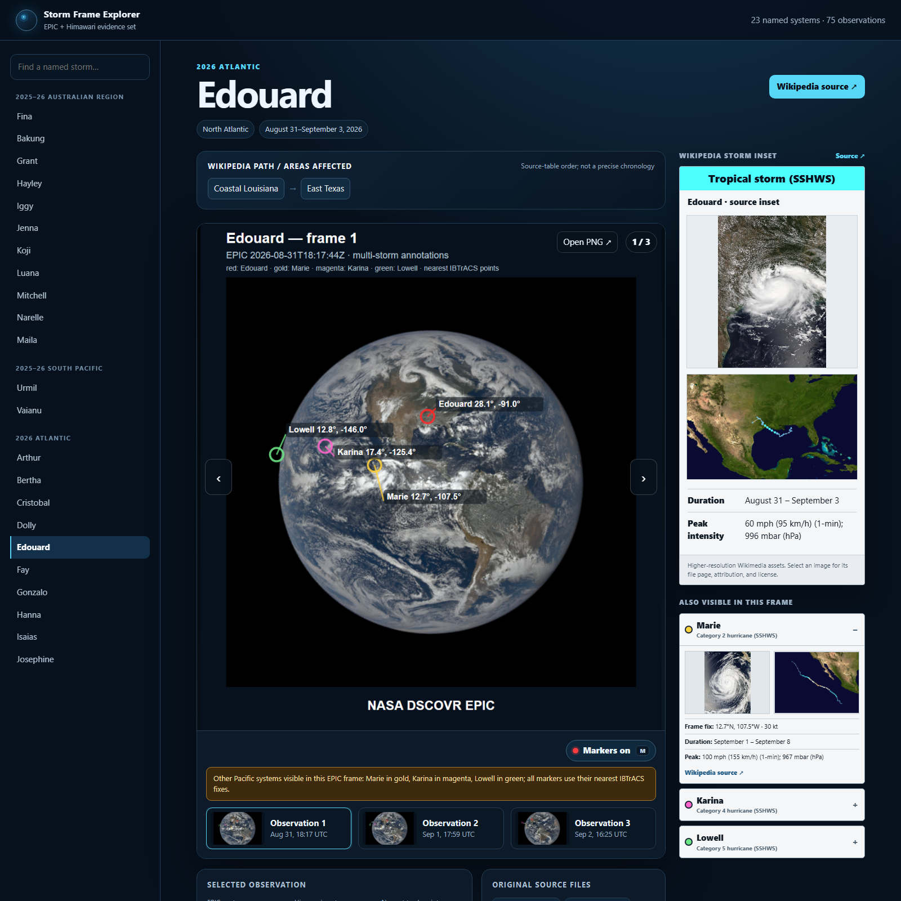

# Cyclone Earthview

Explore hurricanes and tropical cyclones from space through paired NASA DSCOVR EPIC and NICT Himawari satellite imagery.

Cyclone Earthview is a reproducible image collection and interactive browser for named storms. It combines full-Earth observations, storm-centered zooms, NOAA track data, and reference material into a chronological view of each system.



## Highlights

- 23 named tropical systems across the Australian region, South Pacific, and North Atlantic
- 75 selected observations with UTC capture times, positions, and wind speeds
- Side-by-side NASA EPIC and Himawari views where coverage overlaps
- Annotated and marker-free imagery
- High-resolution storm zooms for every observation
- Track maps, satellite references, intensity summaries, and source links
- Keyboard navigation and persistent display controls

## Explore the collection

Open [`storm_image_pairs/index.html`](storm_image_pairs/index.html) in a browser. The viewer is self-contained and does not require a build step or application server.

The complete checkout is approximately 1.5 GB because it retains the original high-resolution imagery and source tiles used to build every zoom.

Use the interface controls or keyboard shortcuts to move through the collection:

- `M` toggles storm markers
- `Z` switches between full-disk and storm-zoom views
- Previous/next controls and the filmstrip navigate between observations

## Collection overview

| Season and region | Named systems |
| --- | --- |
| 2025–26 Australian region | Fina, Bakung, Grant, Hayley, Iggy, Jenna, Koji, Luana, Mitchell, Narelle, Maila |
| 2025–26 South Pacific | Urmil, Vaianu |
| 2026 North Atlantic | Arthur, Bertha, Cristobal, Dolly, Edouard, Fay, Gonzalo, Hanna, Isaias, Josephine |

Most storms have three observations selected around peak intensity. Arthur, Bakung, and Bertha include two additional frames. Every observation includes a storm-centered high-resolution zoom.

## Repository structure

```text
.
├── storm_image_pairs/
│   ├── index.html          # Interactive viewer
│   ├── manifest.csv        # Observation-level metadata and provenance
│   ├── named_storms.csv    # Storm-level metadata
│   ├── data/               # IBTrACS and viewer sidecar data
│   ├── images/             # Source and generated comparison imagery
│   └── wiki_panels/        # Satellite and track reference assets
└── tools/
    ├── pull_storm_images.py
    └── pull_storm_zooms.py
```

More detailed notes about the dataset and special-case frames are available in the [collection documentation](storm_image_pairs/README.md).

## Rebuild the viewer

The collection scripts use the Python standard library. Rebuilding raster comparison images additionally expects WSL with Google Chrome or Microsoft Edge installed on Windows.

Rebuild `index.html` from the existing manifests and assets without downloading data:

```bash
python3 tools/pull_storm_images.py --render-index-only
```

Run the complete collection pipeline:

```bash
python3 tools/pull_storm_images.py
```

Add high-resolution zoom assets for a storm already in the collection:

```bash
python3 tools/pull_storm_zooms.py --storm Mitchell
```

Enrich every storm that does not yet have a complete zoom set:

```bash
python3 tools/pull_storm_zooms.py --all-missing
```

The scripts access remote archives, so a complete rebuild requires an internet connection and may take time. Existing source files and generated outputs are retained to preserve provenance.

## Data sources

- [NASA DSCOVR EPIC](https://epic.gsfc.nasa.gov/) — full-Earth natural-color imagery
- [NICT Himawari](https://himawari8.nict.go.jp/) and its [historical archive](https://himawari.asia/) — geostationary full-disk imagery
- [NOAA/NCEI IBTrACS v04r01](https://www.ncei.noaa.gov/products/international-best-track-archive) — storm positions and wind data
- Wikipedia season articles and Wikimedia Commons — storm summaries, track maps, and reference images

All viewer and manifest timestamps are UTC. Wikimedia assets link to their file pages, where creator, attribution, and license information is recorded.

## Accuracy notes

Storm coordinates and wind values come from the nearest available IBTrACS fix. Affected-area paths summarize the linked season tables and should not be interpreted as exact track chronology. Post-track remnant observations and frames containing multiple storms are identified explicitly in the viewer and manifest.
